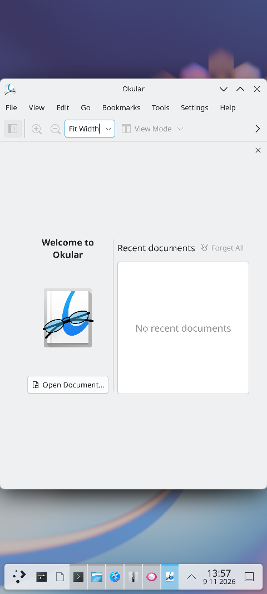
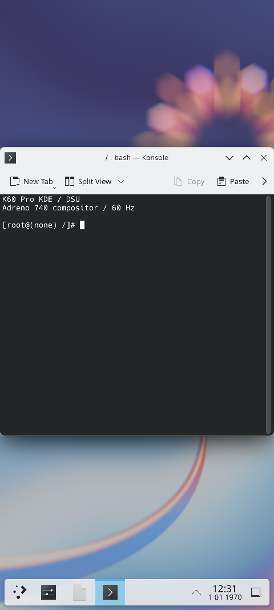

# Arch Linux ARM / KDE Plasma：K60 Pro 已验证镜像

本包保存 **3 GiB KDE v4 system 镜像**，不是主线 Linux 内核，也不是手机 userdata 备份。它利用已有 Android 内核，以 DSU 方式运行 Arch Linux ARM 桌面。

| 项目 | 内容 |
| --- | --- |
| 机型 | REDMI K60 Pro / socrates |
| 镜像 | `images/system.img` |
| 原始大小 | 3,221,225,472 字节 |
| SHA256 | `4e044e6358f8a76000fa3ab2325de96c412dfee87907d4db57bca62ca4494d19` |
| 桌面 | KDE Plasma / KWin，1440×3200、60 Hz |
| GPU | Adreno 740，Turnip KGSL / Zink 合成 |
| 应用 | Dolphin、Kate、Ark、Gwenview、Okular；未安装浏览器 |

## 已验证与限制

桌面、触摸、常用应用和原数据卷上的重启持久化已经实测；拖动残影已处理，屏幕固定为 60 Hz，避免先前 120 Hz 下的横向花线。plasmashell 的 Qt Quick 使用软件后端，KWin 和相应渲染路径仍使用 Adreno GPU。

**本包保持原始已验证镜像摘要不变。** 后来的 Wi-Fi 和应用菜单运行时修复不烘焙进这份历史 system 镜像；有些修复和设置可能保留在原持久卷中，不能承诺空白数据卷具有相同状态。Wi-Fi 后续源码和未复验新镜像见仓库 `docs/ARCH_WIFI.md`；扬声器、电源／音量键和亮度控制没有作为本镜像的完整验收结论。

## 启动条件

先阅读 `../common/DSU启动注意事项.md`。本镜像保留了原 ext4 持久卷的 UUID／标记依赖，必须保留与之匹配的原 DSU 数据及元数据。只解压 system.img 并不能重建它们；不要随意格式化 userdata、换 UUID 或把镜像套到 myron 上。

原命名槽为 `kde20261109`。`../common/enable-existing-dsu.sh arch --check` 只检查；明确加 `--boot` 才启用已有 DSU。它不安装本包的镜像。

## 界面效果图

以下均来自 K60 Pro 历史真机桌面的画面采集，没有把离线渲染标成实机结果。截图时间、窗口和状态栏仅代表采集当时，不代表当前设备状态。

## 校验与源码

解压后按包根目录 SHA256SUMS 校验。构建和驱动源码：<https://github.com/Dingtaiqi/socrates-Arch>；原始镜像校验记录见 `arch/source-record.json`。本包不附个人数据卷；原始 system 镜像保留历史调试设置，并未宣称已完成全面去个人化审计，勿当作通用公开发行版转发。
