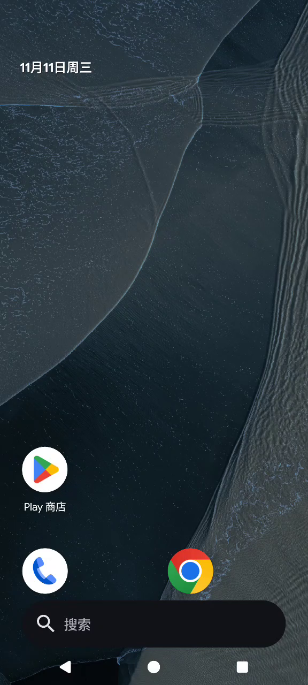

# Evolution X：K60 Pro 已验证 DSU 修复版

本包目标为 **历史 b66 经运行时兼容修复后的精确 system 镜像**，不是后来重新编译、尚未实机启动的全量 ROM。

| 项目 | 内容 |
| --- | --- |
| 机型 | REDMI K60 Pro / socrates |
| 镜像 | `images/system.img` |
| 系统框架 | Android 17 的 EvoX 移植环境 |
| 原始大小 | 2,791,727,104 字节 |
| SHA256 | `648b759526ad703f88d5001c3711f5b28773d429165e1a5cef6d508c741ade3f` |
| 历史命名 DSU | `evox20261111` |

## 兼容修复与实测范围

本版本通过现有 KernelSU 域进入 DSU 宽松 SELinux 环境，并在 DSU 的挂载命名空间里只读绑定过滤后的 vendor HAL 清单，去掉无法运行的旧 OMX 声明。原厂 vendor 分区没有因此改写。

已经验证 DSU 开机、scrcpy 3.1／5.0.1 编码链、前后摄预览；机主确认重新安装的原生 Aperture 可用。它不是全部相机模式、完整通话、全部传感器和长期稳定性的回归结论。音频编码器初始化成功不等于扬声器所有场景均已听测。

本镜像需要已有兼容内核提供 `u:r:ksu:s0`。它不是任意未 root K60 Pro 的通用 GSI。退出 DSU、重启回 HyperOS 会重新加载宿主 SELinux 策略。

## 启动和相机应用

先阅读 `../common/DSU启动注意事项.md`。保留原 EvoX userdata 和命名 DSU 记录时，可用共同辅助脚本先检查，再明确请求单次启动；脚本不会导入镜像或自动替换现有系统。

原生 Aperture 当时安装在 EvoX 的 userdata 中，**不在本 system 镜像内**。本包不复制个人 userdata。若原应用已不存在，请在确认已进入 EvoX 后，安装可信来源的 `org.lineageos.aperture` APK；只导入 system.img 不会自动重建相机应用。相关源码与既有 APK 身份记录见仓库 `evox/dsu/inputs.json`，其确切源码构建身份仍未核实。

不要拿原始 b66、离线重做的兼容镜像或新编译全量 ROM 冒充这份已验证文件；它们的 SHA256 不同。不要使用全局 `gsi_tool wipe` 覆盖已有 Arch 或其他 DSU。

## 界面效果图

以下为 2026-11-11 从 K60 Pro EvoX 获取的桌面帧，属于实机画面；不是本次打包后重新启动的截图。包不包含截图之外的录屏、相机画面或私人应用数据。

源码和原验收记录：<https://github.com/Dingtaiqi/socrates-Arch/tree/main/evox/dsu>，以及仓库 `docs/evox-dsu-runtime-2026-11-11.json`。
